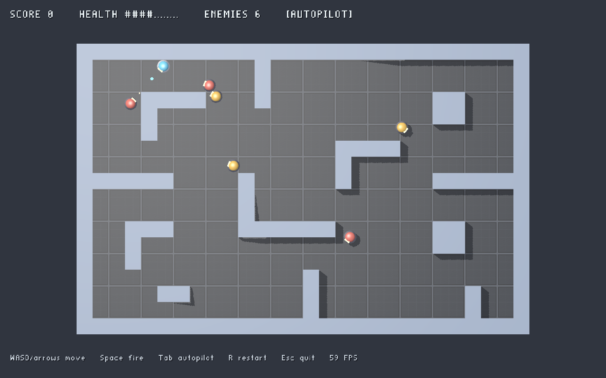

# LightGameEngine

A small, modular C++20 game engine for modern versions of classic games, built on the
LightVulkanGraphics rendering library.

The engine provides the game-side layers — fixed-timestep loop, entity/component
storage, world management, input mapping, 2D collision, grid pathfinding and asset
paths — and talks to the GPU only through an abstract renderer interface. Graphics are
supplied by a thin adapter over LightVulkanGraphics; a `NullRenderer` lets everything
run headlessly for tests and CI.



## Relationship to LightVulkanGraphics

```
game (examples/RobotArena, your game repo)
        │  uses only engine types
        ▼
LightGameEngine  (Core, ECS, Scene, Input, Physics, AI, Assets, Rendering interface)
        │  IRenderer / IPlatform
        ├──────────────► NullRenderer + HeadlessPlatform   (no GPU, no window)
        ▼
LightVulkanBackend  (backends/Vulkan — the only code that includes LightVulkanGraphics/GLFW)
        ▼
LightVulkanGraphics 3.2+ (Vulkan, window, instanced shapes, custom meshes, lights, text)
```

LightVulkanGraphics is used unmodified, as an installed CMake package. No Vulkan, GLFW
or LightVulkanGraphics type appears in any engine header outside `backends/Vulkan/src`.
See [docs/architecture.md](docs/architecture.md) and [docs/rendering.md](docs/rendering.md).

## Platforms

- **Linux:** developed and tested (GCC 14, Clang; X11 and Wayland via LightVulkanGraphics' GLFW).
- **Windows:** the code avoids platform-specific APIs except where noted (asset-root
  discovery falls back to the working directory); not yet built or tested.
- **macOS:** untested; see the HiDPI limitation below.

## Dependencies

| Dependency | Needed by | Notes |
|---|---|---|
| CMake ≥ 3.20, C++20 compiler | everything | |
| GLM | everything | `sudo apt install libglm-dev` |
| LightVulkanGraphics ≥ 3.2 (3.3 recommended) | Vulkan backend, graphical examples | installed package, or `LGE_LIGHTVULKANGRAPHICS_SOURCE_DIR` |
| GLFW 3 headers | Vulkan backend | input is read from the window LightVulkanGraphics owns |

No dependency is downloaded during the build. The test framework is a small in-repo
harness (`tests/TestHarness.h`), so tests need nothing extra.

## Building

```bash
cmake -S . -B build -G Ninja          # or: cmake --preset default
cmake --build build
```

Useful options:

| Option | Default | Effect |
|---|---|---|
| `LGE_BUILD_VULKAN_BACKEND` | `ON` | Build the LightVulkanGraphics backend and graphical examples. Turned off automatically (with a warning) if LightVulkanGraphics ≥ 3.2 is not found. |
| `LGE_LIGHTVULKANGRAPHICS_SOURCE_DIR` | empty | Use a LightVulkanGraphics source checkout when no installed package is found. |
| `LGE_BUILD_EXAMPLES`, `LGE_BUILD_TESTS` | `ON` at top level | Off by default when the engine is embedded with `add_subdirectory()`. |
| `LGE_WARNINGS_AS_ERRORS` | `OFF` | `-Werror` / `/WX` on engine targets. |
| `LGE_ENABLE_SANITIZERS` | `OFF` | ASan + UBSan (GCC/Clang). |

Headless-only build (no Vulkan needed): `cmake --preset headless && cmake --build --preset headless`.

## Running the examples

```bash
./build/examples/BasicWindow/BasicWindow      # window, clear colour, resize, Esc to quit
./build/examples/BasicScene/BasicScene        # primitives, custom-mesh terrain, lights, P toggles projection
./build/examples/RobotArena/RobotArena        # the playable demo
./build/examples/RobotArena/RobotArena --autopilot   # watch it play itself
./build/examples/GettingStarted/GettingStarted       # headless minimal game from the docs
```

Every graphical example accepts `--frames N` (quit after N frames) and
`--screenshot file.png` (save a late frame), which the Vulkan smoke tests use.

### RobotArena controls

| Input | Action |
|---|---|
| W A S D / arrow keys | Move (screen-relative: up is north) |
| Space / left mouse | Fire |
| Tab | Toggle autopilot |
| R | Restart after winning or losing |
| Esc | Quit |

Destroy all six robots (red sentries take 3 hits, orange hunters 2) before your 12
health runs out. Enemies patrol with A* paths, chase when they see you (line of sight is
a ray cast against the walls), search where they last saw you, and shoot back.

## Running the tests

```bash
ctest --test-dir build -LE vulkan     # headless unit + integration tests (no GPU)
ctest --test-dir build -L vulkan      # graphical smoke tests (need a display and Vulkan device)
ctest --test-dir build                # everything
./build/tests/EcsTests "each()"       # one suite, filtered by test-case name
```

| Label | Suites |
|---|---|
| `unit;headless` | CoreTests, EcsTests, InputTests, PhysicsTests (incl. AI), SceneTests, RenderingTests, EngineTests (incl. assets), architecture check |
| `headless` (integration) | RobotArenaHeadlessTests — the full game for a simulated minute, determinism across frame rates |
| `vulkan;integration` | BasicWindow, BasicScene and RobotArena run for a fixed number of frames with screenshots |

## Using the engine from your own game repository

```cmake
add_subdirectory(path/to/LightGameEngine lightGameEngine)
target_link_libraries(MyGame PRIVATE LightGame::Engine LightGame::RendererVulkan)
```

See [docs/getting-started.md](docs/getting-started.md) for a complete minimal game.

## Current limitations

- **Rendering features** are those LightVulkanGraphics provides: lit/unlit instanced
  primitives (cube, sphere, cylinder, cone, capsule) with per-object colour, emissive
  and optional texture; vertex-coloured custom meshes; up to 16 directional/point/spot
  lights with directional/spot shadows; screen text. There are no sprites, skeletal
  animation, particles or post-processing in the engine yet.
- **Custom meshes** cannot be textured, and their material colour is baked into a
  per-(mesh, material) copy of the vertex data.
- **Camera roll** is not representable by the LightVulkanGraphics camera.
- **Window extent on HiDPI with LightVulkanGraphics 3.2:** 3.2 has no swapchain-size
  query, so the backend reports the window size, which understates the drawable size on
  macOS Retina displays. 3.3 provides the query and renders at native resolution.
- **Not implemented yet:** audio, animation, controller input, fullscreen toggling,
  asynchronous asset loading, rigid-body dynamics, 3D collision, behaviour trees,
  scene serialisation, an install/export package for the engine itself.
- Three LightVulkanGraphics 3.2 issues (fixed in 3.3) are worked around in the adapter
  when building against 3.2; see
  [docs/rendering.md](docs/rendering.md#workarounds-for-lightvulkangraphics-32).

## Licence

Not yet chosen. LightVulkanGraphics is LGPL-3.0-or-later; the engine links to it dynamically.
